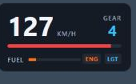

# Car HUD

A clean, lightweight vehicle HUD for FiveM. It shows speed, gear, RPM, fuel, engine health and lights, and appears only while you're in a vehicle. It works standalone or with ESX.



## Features
- Speed in km/h or mph
- Gear indicator, including reverse and neutral
- RPM bar with a redline warning
- Fuel bar that turns orange when low
- Engine health warning (orange when damaged, red when critical)
- Headlight indicator
- Players can toggle it with **F9** (rebindable in GTA's key settings)
- Admins can toggle it for any player with `/hudtoggle [id]`
- Colours, position and units all set in `config.lua`
- Sleeps at 500 ms when you're on foot, so it costs almost nothing

## Installation
1. Put the `car-hud` folder in your server's `resources` directory.
2. Add `ensure car-hud` to your `server.cfg`. If you use ESX, put it after `es_extended`.
3. Edit `config.lua` to set the framework, units, default visibility, position and theme.
4. Restart your server.

## Usage
| Who | How | What it does |
|---|---|---|
| Any player | **F9** or `/carhud` | Shows or hides your own HUD |
| Admin | `/hudtoggle` | Toggles your own HUD |
| Admin | `/hudtoggle 12` | Toggles the HUD for player 12 |

### Admin permission
- **ESX** (`Config.Framework = "esx"`): players in `Config.AdminGroups` (default `admin`, `superadmin`).
- **Standalone**: players with the ACE permission. Add this to `server.cfg`:
  ```cfg
  add_ace group.admin carhud.admin allow
  ```

## Localization
Strings live in `locale/en.lua`. To add a language, copy it to e.g. `locale/de.lua`, change `Locales['en']` to `Locales['de']`, translate the text, and set `Config.Locale = "de"`.

## Adding QBCore
Only the admin check uses a framework. To support QBCore, add a branch in `isAdmin()` in `server/server.lua`, for example using `QBCore.Functions.HasPermission(source, 'admin')`, and set `Config.Framework = "qbcore"`.

## Security
- `/hudtoggle` is checked on the server, so clients can't toggle other players' HUDs.
- The HUD only reads your own vehicle's data and sends nothing to the server.

## License
MIT. See [LICENSE](LICENSE). Made by FS Labs.
